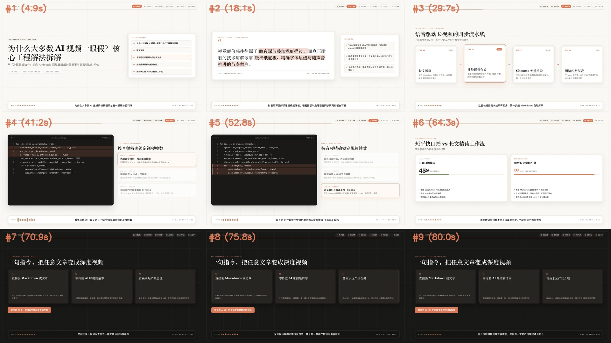

# Arise-video-skill — Zero-Blue Editorial AI Video Workflow

**暖纸编辑排版风（Warm Editorial）AI 视频工作流 & Agent Skill。** 彻底摒弃暗蓝夜景、荧光紫描边、OpenCV 锯齿框等常见「AI 味」，内置 **口播实拍混剪 + 纯浏览器矢量发布片 + 任意时长文章精读讲解** 三大引擎，并可通过一句自然语言指令自动触发。

---

## 实测成片效果预览（Zero-Blue Editorial）

### 引擎 1 · 口播实拍 + 建筑风 NLE 时间轴（`fable_studio.py`）


### 引擎 3 · 长文精读讲解模式（`explainer_studio.py` + `explainer_stage.html`）


---

## 核心特性：四大「去 AI 味」设计铁律

1. **Zero-Blue Rule（零冷蓝铁律）**：75% 画面采用暖棉纸 `#FAF9F5` / `#F3F1EA` 与 `1px` 细线 `#DFDCD2`，25% 采用暖碳黑 `#141413` / `#1C1B19` 反差，焦点唯一指定陶土橘 `#D97757` 与鼠尾草绿 `#788C5D`；Google Flow 灯光词条强制使用暖钨丝主光 + 柔和琥珀轮廓光。
2. **建筑风 NLE 时间轴转场**：用 `1px` 标尺网格 + Double-Bezel 监看视口 + 3 轨时间轴（`01 / VIDEO TRIM`、`02 / ZOOM · Z` 贝塞尔曲线、`03 / VOICE 48K`）替代假夜空大楼与霓虹高速公路。
3. **浏览器级矢量与物理弹簧引擎**：基于 Headless Chrome (`Playwright`) 渲染 Double-Bezel 卡片、原生 `⌘⇧⌥` 键帽、CSS 精密字距与谐振阻尼弹簧运动（`spring_ease`）。
4. **音画绝对同步与冷蓝量化巡检**：长文讲解模式根据真实语音时长反推渲染帧数（`n_frames = round(dur * fps)`）并输出底部声浪与分句字幕；每次 `verify` 自动统计 `cold_blue_pixel_pct` / `ui_beat_cold_blue_pct` 并生成 9 宫格验片图。

---

## 三大渲染引擎架构

| 引擎 | 核心脚本 | 适用场景 |
| :--- | :--- | :--- |
| **1. 口播实拍 + 动效混剪** | `fable_studio.py` | Google Flow (Veo) 实拍口播底片 + 人物抠像遮罩 + 贴纸拍立得 + 建筑时间轴（支持任意 `>= 2` 段与 `16:9` / `9:16`） |
| **2. 纯浏览器矢量发布片** | `web_stage/render_web_stage.py` + `web_stage/stage_template.html` | 无真人出镜的软件/产品 Launch 视频，100% Chrome SVG/CSS3 渲染、`0.00%` 冷蓝 |
| **3. 长文精读讲解（不限时长）** | `explainer_studio.py` + `web_stage/explainer_stage.html` | 1~20+ 分钟长文章 / Markdown 自动拆章讲解，支持 `edge-tts` / `say` 配音、原文扫光划重点、流程图、代码逐行聚焦与 Bento 对比 |

---

## 安装为 Agent Skill

可直接把本仓库克隆到你的本地 Agent Skill 目录，在对话中用一句话（例如 *"把这篇文章做成讲解视频"* 或 *"用 fable-video-workflow 做一期《今日AI大事件》"*）自动触发：

```bash
git clone https://github.com/sqoder/Arise-video-skill.git ~/.gemini/config/skills/fable-video-workflow
```

---

## 本地环境依赖与 CLI 快速上手

- **Python 3.10**：需包含 `opencv-python`、`numpy`、`Pillow`、`playwright`、`edge-tts`
- **浏览器 & 媒体工具**：Google Chrome、`ffmpeg`、`ffprobe`

### 1. 长文 / Markdown 一键生成讲解长视频

```bash
PY=${PYTHON_BIN:-python3}

# 从任意 Markdown 文章自动拆章生成工程配置
$PY explainer_studio.py from-markdown -i sample_article.md -o explainer_project.json

# 配音合成 -> 提取 RMS 声浪 -> Chrome 逐帧渲染 -> FFmpeg 混音
$PY explainer_studio.py render -p explainer_project.json -o output/《文章精读讲解》成片.mp4

# 校验音画流、冷蓝占比与 9 宫格验片图
$PY explainer_studio.py verify -v output/《文章精读讲解》成片.mp4 -o output/verify_explainer_grid.jpg
```

### 2. Google Flow 真人口播 + Fable 动效合成

```bash
PY=${PYTHON_BIN:-python3}

# 初始化任意 N 段配置（支持 16:9 横屏 / 9:16 竖屏）
$PY fable_studio.py init -o project.json --aspect 16:9 --segments 3

# 生成脱敏安全的 Google Flow 提示词任务清单
$PY fable_studio.py flow-plan -p project.json -o output/flow_tasks.json

# 将生成的 clips/seg_01.mp4 .. 合成最终成片并验片
$PY fable_studio.py render -p project.json -o output/《今日AI大事件》成片.mp4
$PY fable_studio.py verify -v output/《今日AI大事件》成片.mp4 -o output/verify_grid.jpg
```

---

## 目录说明

- `SKILL.md` / `scripts/`：Agent Skill 触发规范与全套脚本镜像
- `explainer_studio.py`：长文精读讲解 CLI 引擎（含 `from-markdown`、`edge-tts` + `say` 降级）
- `fable_studio.py`：口播实拍动效合成 CLI 引擎
- `web_stage/`：Headless Chrome HTML5/CSS3/SVG 舞台模板（`explainer_stage.html`、`stage_template.html`、`render_web_stage.py`）
- `project.json` / `explainer_project.json` / `sample_article.md`：示例工程配置与示范 Markdown 文章
- `assets/`：AI 生成的默认演示占位形象锚点图（仅作示例占位，不含大体积 `.mp4` 原片）
- `output/`：9 宫格预览图与脱敏任务示例 JSON（`.gitignore` 自动忽略 `.mp4` 等大体积音视频文件）

---

## License

MIT — see [LICENSE](LICENSE).
